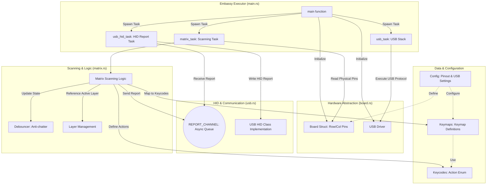

# Mira Firmware

Mira Firmware is a Rust-based firmware for custom keyboards powered by the RP2040 microcontroller (e.g., Raspberry Pi Pico).
It leverages the **Embassy** framework to provide a high-performance, asynchronous architecture, ensuring low-latency and responsive key input.

## Architecture

The following diagram illustrates the core components and their interactions within the firmware.

### Core Components

1.  **`main.rs` (Executor)**: The system entry point. It initializes hardware and spawns the matrix scanning and USB communication tasks to run in parallel.
2.  **`board.rs` (HAL)**: Abstrates RP2040 GPIO pins (rows/columns) and USB peripherals for the rest of the system.
3.  **`matrix.rs` (Logic)**: 
    *   Scans physical matrix states and handles noise via `debounce.rs`.
    *   Converts physical button presses into specific keycodes or layer-switch actions using `layers.rs` and `keymaps/`.
4.  **`usb.rs` (Transport)**: Receives key inputs from the scanning task via `REPORT_CHANNEL` and transmits them to the host PC as standard USB HID reports.
5.  **`config.rs` & `keycodes.rs`**: Define constants such as pin assignments, USB Vendor IDs, and action types (standard keys, modifiers, layer toggles, etc.).

## Development Environment

- Rust (Nightly recommended)
- `flip-link` (Stack overflow protection)
- `probe-rs` (Flashing and debugging)

## License

This project is licensed under the MIT License.
